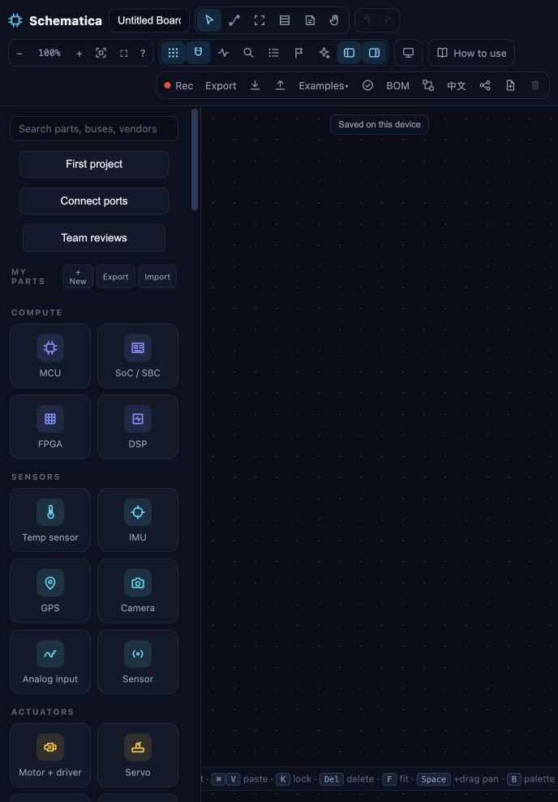
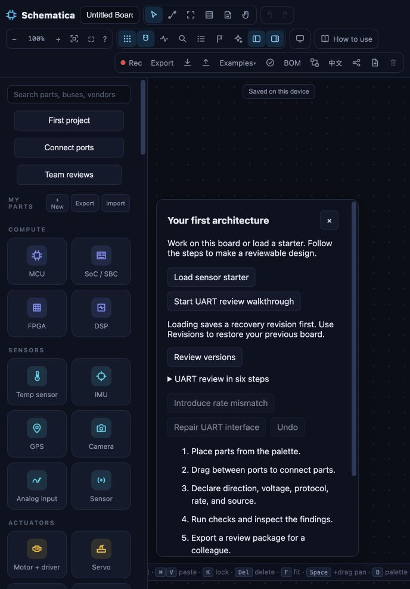
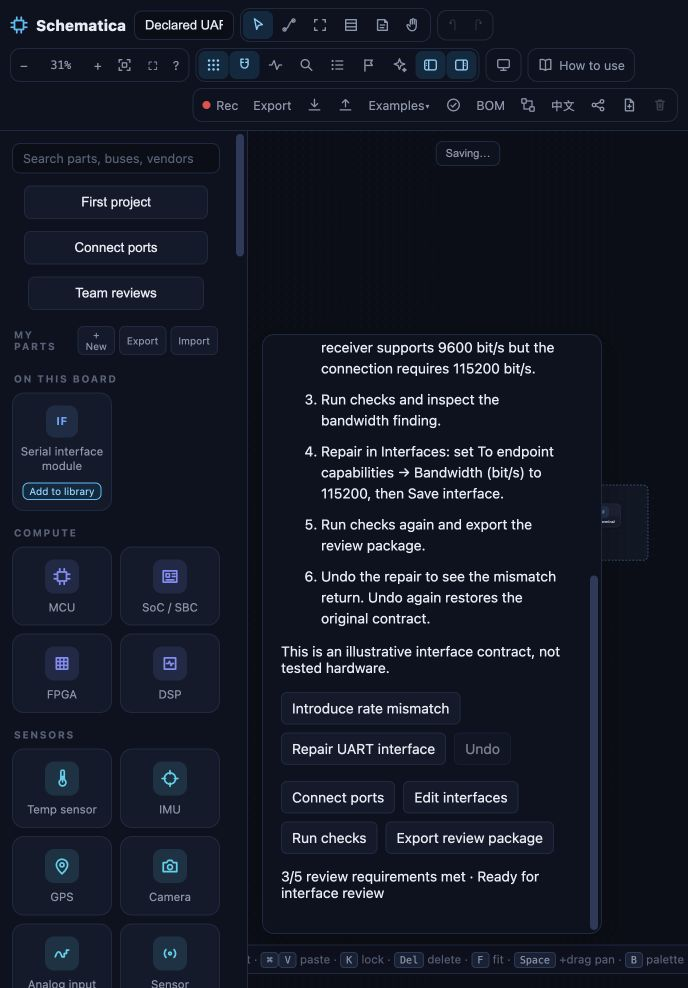
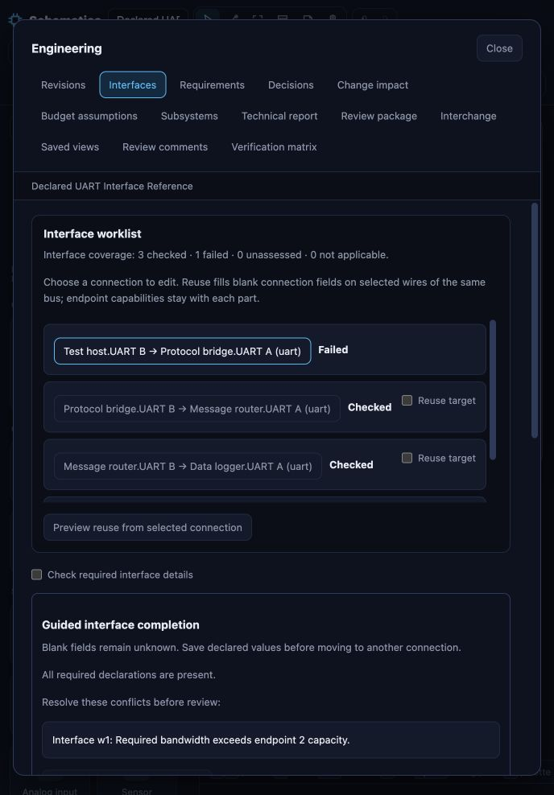
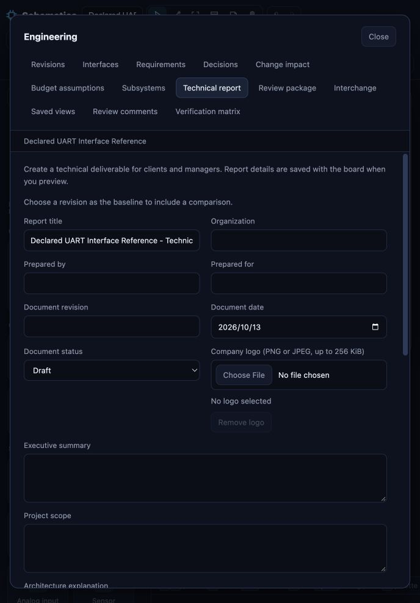
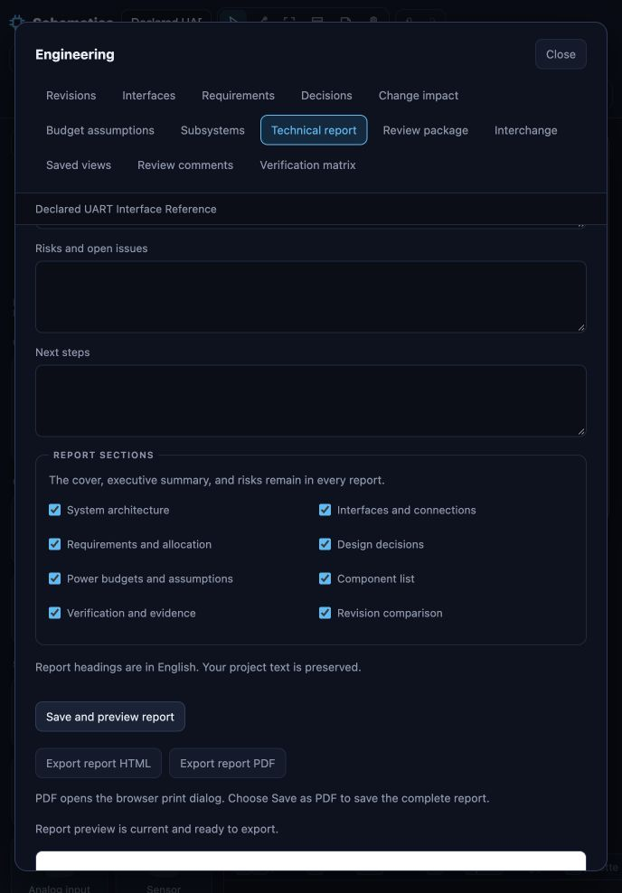

# Schematica gap review — 13 October 2026

**Implementation update:** The first two priorities below are implemented locally: startup recovery and Engineering draft/focus retention. See the follow-up results at the end. The guided Prepare → Check → Resolve → Handoff path (P2) shipped on 24 October 2026 as the **Review path** panel; see the [user guide](user-guide.md#follow-the-review-path). The remaining priorities are still open.

Reviewed commit fec15ad6adf4db82cce1a2e3735415b5f3b7ed7c. The working tree was clean at the start. Findings and baseline evidence below describe that commit. The follow-up implementation is recorded at the end of this document.

**Judgment:** Schematica already has a credible embedded-architecture review workflow. The most useful next investment is making that workflow dependable and easy to repeat on real projects. Feature breadth is ahead of the evidence that engineers can adopt it successfully.

The proposed outcome remains: an engineer can explain a design change, resolve or explicitly leave unknown interface declarations, and give a colleague a reviewable handoff. This is a product recommendation grounded in the repository, not a measured customer preference.

Fresh verification: **1,126 Node tests passed, zero failures or skips; source checks passed.** A local in-app-browser walkthrough confirmed mismatch creation, interface repair, and an export-ready technical report preview. Source probes confirmed the recovery and CSV boundaries below. The existing Chrome/Firefox CI workflow already includes substantial engineering, report, guide, history, and team coverage; adding another generic smoke test is not the main gap.

The October 7 review should not be reused as an unchanged backlog. Guided UART onboarding, keyboard connections, teaching references, repeatable KiCad updates, authenticated revision-bound team reviews, and evidence-collection tools have shipped. Technical reports and assistant conversation history also exist. A fresh example census found 31 examples and four review-ready declared references: UART, power, I2C and CAN. The other examples can legitimately remain sketches or teaching scenarios; their readiness count is not a quality score.

| Priority | Gap | First useful deliverable | Completion evidence | Effort |
| --- | --- | --- | --- | --- |
| P1 | Startup recovery can hide repairs and overwrite the original autosave | Preserve raw recovery data, show repair warnings, offer a recover/export path | Corrupt and repaired fixtures retain their original bytes through the next edit and reload; users can choose a valid revision | Small–medium |
| P1 | Engineering forms lose unsaved edits and keyboard focus | Per-record drafts, explicit saved/draft state, focus restoration | Edit → switch section → return retains the draft; save/undo behave correctly; keyboard flow stays inside the dialog | Medium |
| P1 | Adoption advantage remains unmeasured | Run the existing five-engineer study on this release | Four of five complete first review without help within ten minutes; compare review/handoff time and seeded-issue detection with their existing workflow | External evidence |
| P2 | Core work is spread across many controls | A guided Prepare → Check → Resolve → Handoff path over existing features | Engineer sessions need fewer navigation/help interventions; unresolved items link directly to the field that needs work | Medium |
| P2 | Repeated projects rely on one local working slot and manual files | A local project switcher with stable IDs, per-project revisions and backup status | Two projects survive switching, reload, cross-tab conflict and failed writes without mixing histories | Medium–large |
| P2 | Engineering knowledge and exchange remain labor-intensive | Versioned reusable interface profiles plus a structured exchange path | Exact source revisions/pages retained; unknowns stay explicit; complete export/import round-trip on three permitted team fixtures | Medium–large |
| P2, before a team pilot | Shared reviews need an operating lifecycle | Capacity visibility, archive/restore policy, easier reviewer access and a measured restore drill | A long-running project can continue past its retention threshold without silent history loss; restore and revocation are demonstrated | Medium–large |
| P2, before broader assistant claims | Assistant and supported-device quality need current evidence | Publish redacted model-rubric results and representative-device measurements | Versioned model/task results, correction rate, measured latency and manual assistive-technology trials | External evidence |

Effort is relative scope, not a delivery estimate. P1 means the next improvement cycle, not that a production incident has been established.

**1. Make recovery explicit before extending storage.**

[Startup loading](../src/main.js) at lines 44–55 takes only the document from deserialization and discards its warnings. A parse failure logs to the developer console and opens a new board. Subsequent edits write to the same autosave key. The cross-tab guard protects against another writer; it does not treat already-observed malformed data as a recoverable startup incident.

An isolated Node probe executed the current loader with in-memory storage, the real deserializer, Store, conflict guard and autosave. Invalid JSON opened an empty board; the next edit replaced the original value. A second fixture contained six nodes with one duplicate ID: it loaded five, emitted no console warning, and replaced the original after an edit. These are controlled malformed-input cases, not evidence that ordinary saves spontaneously corrupt.

Keep an untouched recovery copy before any repair or replacement, surface the warnings, and offer raw export and valid saved revisions. Avoid presenting an empty replacement as successful recovery. The existing named revisions and recent asynchronous-refresh fix are useful foundations.

For the later project switcher, store current boards and revisions under stable project IDs, migrate the legacy slot safely, and show whether the user has an external backup. Browser-local persistence and an off-device backup solve different problems. [MDN documents browser storage quota and eviction behavior](https://developer.mozilla.org/en-US/docs/Web/API/Storage_API/Storage_quotas_and_eviction_criteria); storage estimates or a persistence request can improve resilience but cannot replace a backup.

**2. Preserve drafts and focus throughout Engineering.**

In the browser, I introduced the walkthrough's 9,600 bit/s receiver limit, changed the form value to 115,200, switched to Requirements, and returned to Interfaces. It reverted to 9,600 without a confirmation. The screen does instruct users to save before switching, so this is a confirmed workflow weakness rather than loss of a committed change.

Saving the repair worked: coverage changed from three checked/one failed to four checked/zero failed. Immediately afterward, the active element was BODY. [Engineering rendering](../src/ui/engineering-ui.js) replaces the entire dialog at line 52, and its section handlers at line 236 recreate the form without retaining draft state or restoring focus. An existing focus helper in [press.js](../src/ui/press.js) already serves other panels.

Keep drafts keyed by project, section and record; preserve them during ordinary navigation. Give users explicit Save and Discard actions, and guard only actions that actually abandon work. Restore focus to the equivalent control or a meaningful next step after save. Test close/reopen, changing connections, language changes, validation failures, undo and board replacement. The observed focus drop warrants keyboard and screen-reader verification against [W3C's modal dialog guidance](https://www.w3.org/WAI/ARIA/apg/patterns/dialog-modal/); this review is not a full accessibility compliance audit.

**3. Make the strongest workflow easier to discover.**

At the observed 688 × 988 in-app viewport, the initial screen is a blank canvas surrounded by a large palette and three toolbar rows. First project is available but closed. Its panel offers both the sensor starter and the UART walkthrough; opening the panel initially focuses the sensor starter. The walkthrough then shows six instructions while its status counts five review requirements. Those concepts are individually defensible but require interpretation.

Engineering presents 13 sections at the same level. In the repair screen, the worklist and explanatory blocks fill the initial view; the actual endpoint fields are below the fold. The Repair UART interface action selects the right connection but does not land on the mismatched bandwidth field.

Add a task-oriented entry for a new board, make the review walkthrough the obvious first-success path, and show one current step with the relevant control. Keep advanced tools available. Deep-link findings to exact fields, provide a persistent save action for long forms, and group Engineering sections by work stage. These are hypotheses to test in the pilot, not a request for a visual redesign or more feature panels. The narrow-viewport observations should not be generalized to every desktop size.

**4. Turn declarations into reusable engineering knowledge.**

The four declared examples provide good learning fixtures, but their assumptions are illustrative. Interface sources and requirement evidence are largely text fields. Engineers still have to enter and maintain real limits and references.

A useful next layer is a versioned interface profile with units, exact component/document revision, page or section, review date and owner. Separate an illustrative assumption from a documented declaration and from measured evidence. Reuse should preview which blanks will be filled and which existing values conflict. Updating a profile should identify affected interfaces and stale evidence.

The direct ICD CSV path has exactly nine legacy columns. A probe exported a connection with a numeric rate of 115,200, removed that numeric field from an otherwise matching target board, and reimported the CSV: the numeric rate remained absent. Existing numeric values are preserved when editing the same board through CSV.

This is a **documented scope limit**, not a broken lossless-export promise. Board JSON retains the full model, and review packages already include a richer interfaces-all.csv with scope and numeric limits. Improve discoverability first: distinguish text-only ICD editing from complete model exchange in the UI. If real team workflows require spreadsheet round-tripping, add a versioned structured format with stable endpoint IDs, numeric constraints and an import preview. Do not silently reinterpret free-text rate or voltage notes.

Evidence: [engineering.js](../src/engineering.js), lines 69–85; [engineering workflows](engineering-workflows.md), review-package and numeric-declaration sections; [source probe results](review-assets/2026-10-13/source-probes.json).

**5. Finish the team-review lifecycle before expanding collaboration.**

The service has meaningful protections: authenticated actors, membership, immutable snapshots, revision-bound decisions, concurrency conflicts and private durable storage. It is not missing collaboration entirely.

Its current pilot boundary is explicit: one process, one store file, 100 projects, 100 revisions per project and 64 MiB overall. [The service rejects the next revision at the cap](../server/team-projects.js); the API has no project archive or retention-management route. Export and operator filesystem restore exist, but there is no ordinary user archive/restore lifecycle to free capacity while retaining review history.

The [team UI](../src/ui/team-review.js) also requires an operator-issued token on each dialog session, manual refresh, configured user IDs for membership, and a typed target-item ID for anchored comments. These are acceptable pilot shortcuts but friction for regular reviewers.

Before wider team use, show capacity and approaching limits; define archive and restore behavior; provide a documented credential/session lifecycle; make comments attach by selecting a diagram item; and support opening the intended project/revision directly. Validate notification needs before adding integrations. Choose a transactional database only when the retention, concurrency or measured volume justifies migration. Existing release health checks and rollback should be supplemented by an isolated restore drill and independently recorded availability.

**6. Close the evidence loop.**

The tracked study and current assistant-result files are templates. The repository includes an engineer study kit, evaluation cases, an evaluator, live-provider acceptance tooling and performance reports. Building more harnesses is lower value than running them with the required inputs.

Use five consenting practicing engineers and three permitted representative KiCad designs. Measure completion, time, help requests, missed assumptions, seeded errors and recipient comprehension. Treat any unrecovered loss or missed critical issue separately from averages. The existing proposed 20% review/handoff improvement is a pilot target, not a result.

For the assistant, record provider/model/version, supplied evidence, ungrounded claims, task success, correction effort and preview/apply/undo behavior. Historical experiments or scripted providers do not establish current model quality. Run the existing performance protocol on representative physical laptops and add manual screen-reader sessions. These records may exist outside the repository; this review did not inspect external participant records, production monitoring or private provider runs.

One smaller product gap is bilingual handoff: the editor and guide support Chinese, but technical-report headings are explicitly English. Add report-language selection if Chinese client delivery is a pilot requirement.

**Recommended sequence.**

1. Next change set: recovery quarantine/warnings, Engineering draft retention and focus restoration, with targeted regression cases. Keep the current plain-JavaScript architecture and existing export compatibility.
2. In parallel as a workstream: schedule the existing engineer study and collect permitted fixtures. No outreach was sent during this review.
3. Use observed friction to choose between local project management and reusable declarations/structured interchange as the next substantial feature. A focused review dashboard can expose progress across the existing features.
4. Before team rollout: settle identity, retention, capacity and recovery ownership; then run the restore drill and a two-person review pilot.

Avoid a framework rewrite, simulation engine, PCB editor or simultaneous multiplayer until the evidence identifies those as the actual blocker. Small responsibility extractions around form state, persistence and interchange can support these changes without a platform migration.

**Captured walkthrough and health of each step.**

All six screenshots were captured and reopened from their saved files during this review. They show a fresh local origin, English UI, the default dark appearance and a 688 × 988 viewport. No user boards or credentials were loaded.

1. **First open — functional, weak task guidance.** First project is visible, but the blank canvas offers no central next action. The toolbar wraps at this viewport.

2. **First project — useful guidance, competing starting points.** Recovery is explained. The sensor starter precedes the review walkthrough; generic steps and tutorial controls share a scrolling panel.

3. **UART walkthrough — functional, dense.** The declared board loads, assumptions are explicit, and mismatch/repair actions are available. The focused action scrolls the guidance panel; much of the small diagram is covered at this viewport.

4. **Interface repair — correct checking, draft/focus gaps.** The failed connection and reason are identified. The repair field is below the initial view. The draft-loss and post-save focus observations were reproduced in this screen.

5. **Report setup — functional, long-form entry.** Audience, metadata and narrative fields exist. A baseline is chosen elsewhere, and report settings are saved on preview.

6. **Report preview — passed the observed readiness check.** Saving and previewing produced the current-report status and enabled HTML/PDF exports. A DOM read confirmed the populated report iframe. Download/printing was not exercised in this manual pass.

**Evidence limits.** Node/source checks were run fresh in this review. The startup probe is an isolated test of real source functions, not a browser-storage fault injection or reproduction against a user's saved data. The browser walkthrough was targeted, not the full automated Chrome/Firefox/Safari matrix. No live-provider calls, external interviews, hardware tests, production deployment checks, full accessibility audit or security audit were performed. Findings distinguish reproduced behavior, documented limitations and proposed improvements.

Reproduce the source probes from the repository root with: **node docs/review-assets/2026-10-13/source-probes.mjs**. The command uses in-memory fixtures and writes the adjacent evidence JSON.

## Follow-up implementation — 13 October 2026

The two immediate reliability priorities are implemented in this working tree.

- **Startup recovery:** unreadable or repaired autosaves retain their original contents in separate recovery copies. A persistent notice opens the reported errors or repair warnings, original-data export, and the existing revision history. Marking a copy reviewed retains it. A failed preservation write blocks autosave from replacing the original; retry resumes after storage is available. Tests cover malformed JSON, repaired records, quota failures, initially unreadable storage, cross-tab conflicts, repeated startup, and a changed recovery copy.
- **Engineering drafts and focus:** unsaved changes are kept by section, scope, record, and form within the current tab. Section/record navigation, dialog close/reopen, language changes, validation failures, and a pending review save retain edits. Save commits the form; Discard resets only that form. Saved values remain undoable, a restored draft requires a fresh report preview, and completed logo uploads and report-section choices are retained. Opening another board asks before abandoning drafts; cancelling preserves both the board and drafts. Keyboard focus stays in Engineering after a repaint. Restoring revisions retains the explicitly chosen comparison baseline.

Drafts are not durable across a page reload or tab closure, and are not part of downloaded boards until submitted. Recovery copies remain local to the browser/site. These limits and the recovery actions are now documented in the [user guide](user-guide.md#save-and-recover) and [troubleshooting guide](troubleshooting.md#saving-and-recovery).

Verification: **1,135 Node tests**, source checks, **340 full Chrome checks**, **22 targeted reliability checks**, **17 workflow checks**, and **182 layout checks** passed. Browser suites reported no console errors or exceptions. The final baseline-preservation correction was verified by the targeted reliability suite after the full run. The layout suite covers English and Chinese at desktop, narrow, and landscape sizes. Screenshots were inspected; this is not a manual screen-reader or cross-browser certification. The browser harness now waits for a new document after reload instead of accepting controls from the old page.

[Machine-readable verification](review-assets/2026-10-13/implementation-verification.json) · [Retained Engineering draft](review-assets/2026-10-13/07-retained-engineering-draft.png) · [Original autosave recovery](review-assets/2026-10-13/08-original-autosave-recovery.png)

The next priority remains the existing five-engineer adoption study. These changes improve reliability; they do not establish faster real-world review/handoff or replace participant evidence. No production deployment was performed.
