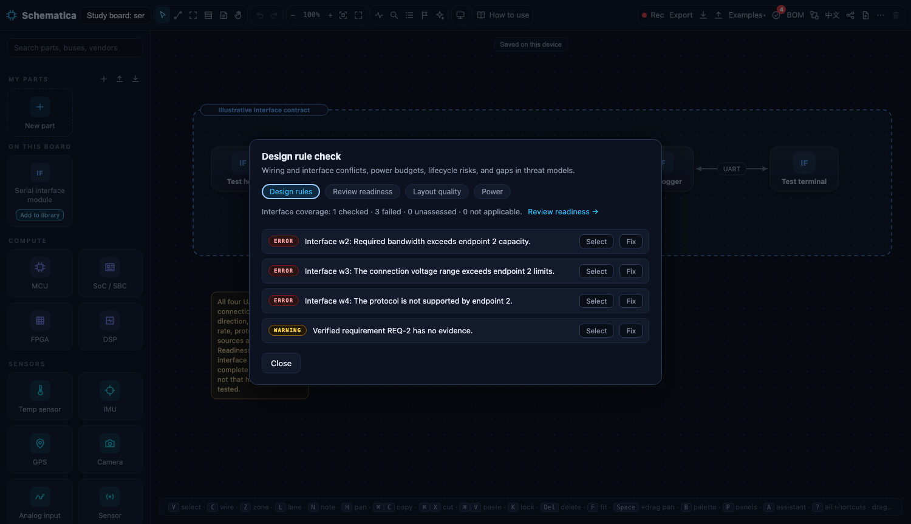
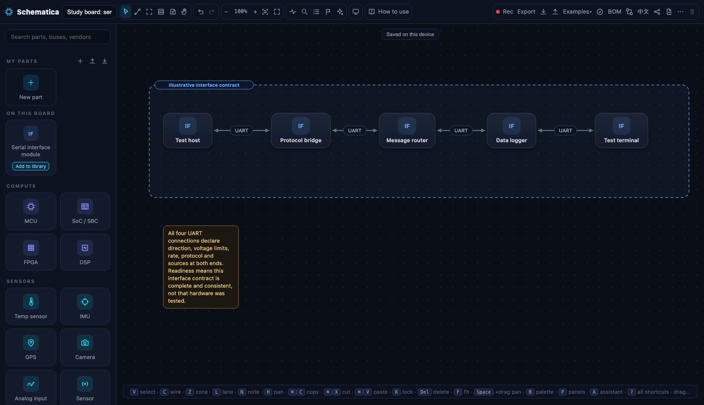
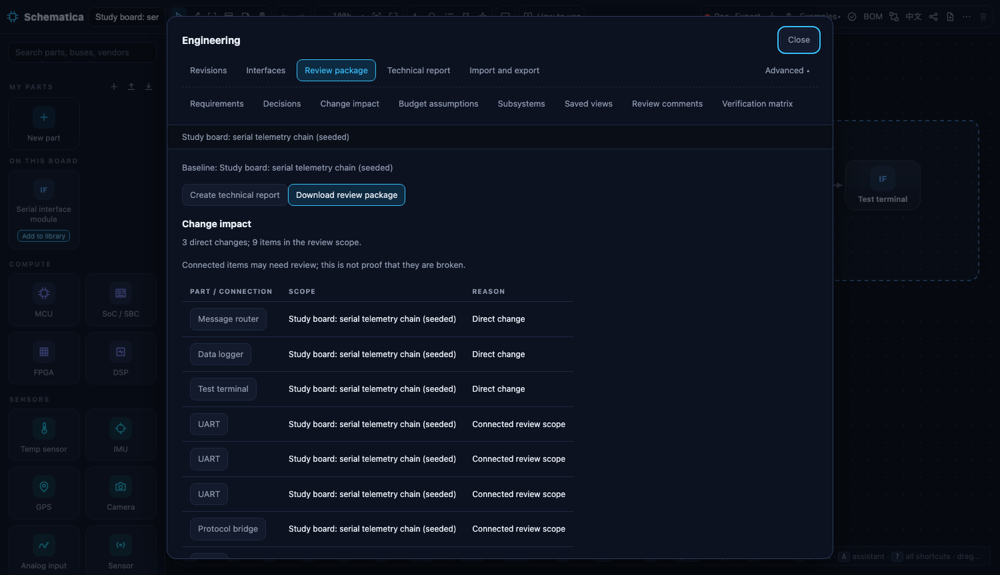

# Study rehearsal — 24 October 2026

A scripted run of the facilitator script's four tasks on the seeded board,
by the browser harness, on the release at commit 3463c90 plus this folder.
It proves the materials match the release. It is not a participant session:
no human timing, help count or debrief exists yet.

Command: `STUDY_E2E_ONLY=1 node tests/e2e/smoke.mjs` (also part of `npm run e2e`).

| Step | Result |
| --- | --- |
| Open the seeded board | Five cards, title *Study board: serial telemetry chain (seeded)* |
| Task 1 review: **Check** | Exactly the four seeded findings, in the answer key's order |
| Name a revision *Seeded baseline* | Listed under Engineering → Revisions |
| Task 2 repair: three interface edits, REQ-2 method and evidence | Check reports none of the seeded findings |
| Name a revision *Repaired* | Listed |
| Task 3 recover: restore *Seeded baseline*, then *Repaired* | Findings return, then clear again |
| Task 4 handoff: *Use as baseline* on *Seeded baseline*, **Download review package** | `architecture-review.html` contains the *Changes from baseline* section, REQ-2, the 115,200 bit/s declarations and the UART-REF-1 source lines |

Scripted wall-clock per task (machine-driven, for harness health only, not
comparable to human times): review 0.2 s, repair 1.1 s, recover 0.2 s,
handoff 0.2 s. See
[study-dry-run.json](../../review-assets/2026-10-24-study-dry-run/study-dry-run.json).

## What the rehearsal changed in the materials

- REQ-2 cannot be repaired with evidence alone: a verified requirement also
  needs a method, and the editor says so in a toast. The answer key and the
  script now say both are required, and REQ-1 was given a method so that
  editing it does not spring the same trap.
- The review package names its comparison section *Changes from baseline*;
  it does not print the baseline revision's label. The recipient quiz asks
  what changed, not which revision was the baseline.

## Not covered by the rehearsal

Baseline-tool tasks, the recipient quiz, consent, the debrief, help counting
and every human timing. Those exist only once participants do.
